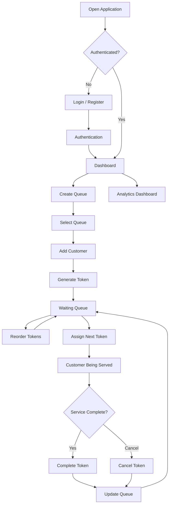
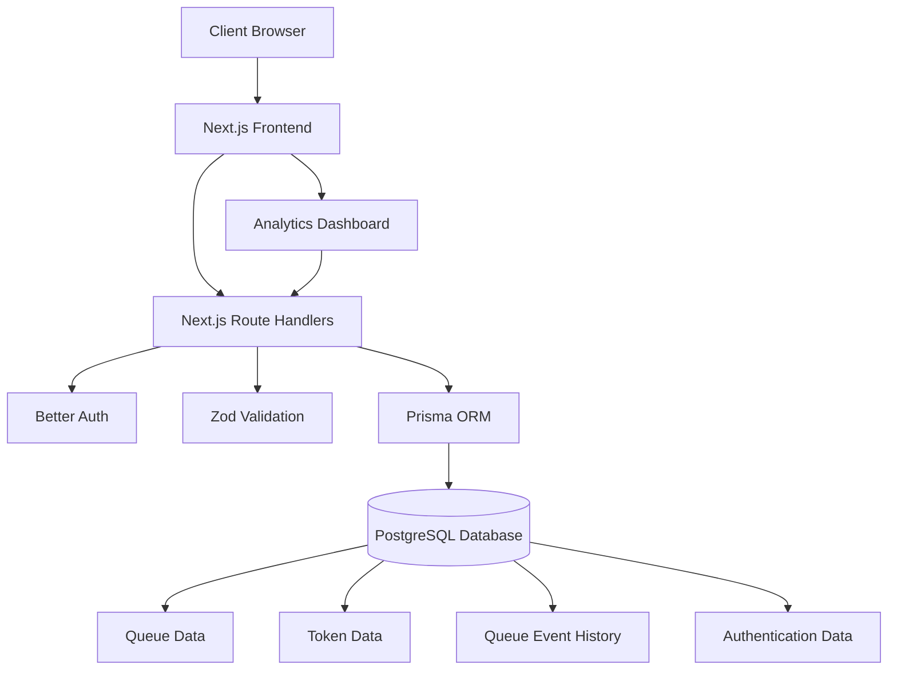
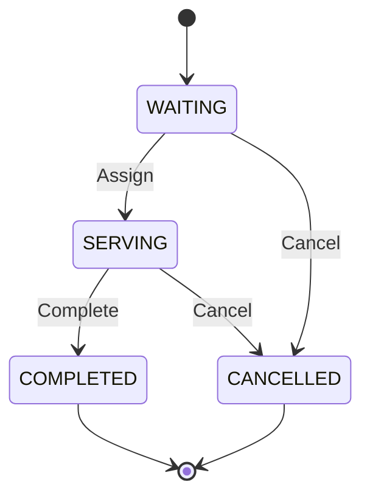

# Queue Management System

A full-stack Queue Management System that helps managers create and manage multiple queues, generate customer tokens, control service order, and monitor queue performance through an analytics dashboard.

Built with **Next.js, TypeScript, PostgreSQL, Prisma ORM, and Better Auth**.

---

## Table of Contents

- [Overview](#overview)
- [Features](#features)
- [Technology Stack](#technology-stack)
- [Application Workflow](#application-workflow)
- [System Architecture](#system-architecture)
- [Queue Management Flow](#queue-management-flow)
- [Token Lifecycle](#token-lifecycle)
- [Database Design](#database-design)
- [Project Structure](#project-structure)
- [API Endpoints](#api-endpoints)
- [Getting Started](#getting-started)
- [Environment Variables](#environment-variables)
- [Database Setup](#database-setup)
- [Running the Application](#running-the-application)
- [Production Build](#production-build)
- [Deployment](#deployment)
- [Security and Data Integrity](#security-and-data-integrity)
- [Future Improvements](#future-improvements)

---

## Overview

The Queue Management System provides a centralized interface for managing customer queues.

A manager can create multiple queues, add customers to a queue, generate tokens, rearrange waiting customers, assign the next customer for service, and complete or cancel tokens.

The application also provides an analytics dashboard to monitor queue activity, waiting times, service times, and queue-length trends.

The system is designed to maintain consistent token ordering and prevent multiple customers from being assigned for service simultaneously in the same queue.

---

## Features

### Authentication
- Manager registration and login.
- Secure session-based authentication using Better Auth.
- Protected dashboard routes.
- Logout functionality.

### Queue Management
- Create and manage multiple queues.
- View all created queues.
- Select a queue to manage its customers.
- View the number of tokens associated with each queue.

### Token Management
- Add customers and generate unique token numbers.
- View waiting customers in a queue.
- Reorder waiting tokens using up/down controls.
- Assign the next waiting customer for service.
- Complete a serving token.
- Cancel a waiting or serving token.
- Maintain permanent token numbers even when tokens are cancelled.

### Analytics Dashboard
- Total number of queues.
- Total tokens generated.
- Tokens generated today.
- Current waiting and serving counts.
- Completed and cancelled token counts.
- Average waiting time.
- Average service time.
- Hourly queue-length trends.
- Queue-wise performance statistics.
- Date-based analytics filtering.

---

## Technology Stack

| Technology | Purpose |
|---|---|
| Next.js 16 | Full-stack React framework |
| React 19 | UI development |
| TypeScript | Type safety |
| Tailwind CSS 4 | Styling |
| PostgreSQL | Relational database |
| Prisma ORM 7 | Database access and migrations |
| Prisma Postgres | Managed PostgreSQL database |
| Better Auth | Authentication and session management |
| Zod | Data validation |
| Recharts | Analytics charts |
| Lucide React | Icons |
| Vercel | Deployment |

---

## Application Workflow

The application follows this workflow:



---

## System Architecture

The project uses a single Next.js application with the App Router and Route Handlers.

There is no separate Express.js backend.



### Architecture Components

**Frontend**
- Next.js App Router.
- React client components.
- Tailwind CSS for responsive UI.
- Recharts for analytics visualization.

**Backend**
- Next.js Route Handlers.
- Better Auth for authentication.
- Zod for request validation.
- Prisma ORM for database operations.

**Database**
- PostgreSQL for persistent storage.
- Prisma schema for database models.
- Prisma migrations for schema versioning.

---

## Queue Management Flow

### 1. Manager Authentication

The manager registers or logs in using the authentication system.

After successful authentication, the manager is redirected to the protected dashboard.

### 2. Create a Queue

The manager creates a queue by providing its name.

Each queue is associated with its respective manager.

### 3. Add Customers

The manager enters a customer's name.

The system generates a unique token number for that queue and adds the token to the waiting list.

### 4. Reorder Tokens

The manager can change the order of waiting customers using the up/down controls.

Reordering changes the token's queue position without changing its original token number.

### 5. Assign Next Customer

The manager clicks the assign button.

The system selects the first waiting token and changes its status to `SERVING`.

Only one token can be in the `SERVING` state per queue.

### 6. Complete or Cancel

After service, the manager can mark the token as completed.

Tokens can also be cancelled when necessary.

### 7. Monitor Analytics

The manager can visit the analytics dashboard to review queue performance and operational statistics.

---

## Token Lifecycle

Each token follows a defined lifecycle.



### Token Statuses

| Status | Description |
|---|---|
| WAITING | Customer is waiting for service |
| SERVING | Customer is currently being served |
| COMPLETED | Service has been completed |
| CANCELLED | Token has been cancelled |

**Important:** Token numbers are permanent and are not reused after cancellation. Queue positions are maintained separately and can change when customers are reordered.

---

## Database Design

The application uses PostgreSQL with Prisma ORM.

### Main Models

| Model | Responsibility |
|---|---|
| User | Stores manager account information |
| Session | Stores authentication sessions |
| Account | Stores authentication account information |
| Verification | Stores verification records |
| Queue | Stores queue information |
| Token | Stores customer token information |
| QueueEvent | Maintains queue activity history |

### Queue

Stores:
- Queue ID
- Queue name
- Manager ID
- Next token number
- Creation timestamp

### Token

Stores:
- Token ID
- Queue ID
- Token number
- Customer name
- Queue position
- Token status
- Creation timestamp
- Assignment timestamp
- Completion timestamp

### QueueEvent

Maintains an audit trail of queue operations.

Event types include:

- `TOKEN_CREATED`
- `TOKEN_REORDERED`
- `TOKEN_ASSIGNED`
- `TOKEN_COMPLETED`
- `TOKEN_CANCELLED`

This event history also supports analytics calculations.

---

## Project Structure

```text
queue-management-system/
│
├── prisma/
│   ├── migrations/
│   └── schema.prisma
│
├── public/
│
├── src/
│   ├── app/
│   │   ├── (auth)/
│   │   │   ├── login/
│   │   │   │   └── page.tsx
│   │   │   └── register/
│   │   │       └── page.tsx
│   │   │
│   │   ├── api/
│   │   │   ├── analytics/
│   │   │   │   └── route.ts
│   │   │   ├── auth/
│   │   │   │   └── [...all]/
│   │   │   │       └── route.ts
│   │   │   └── queues/
│   │   │       ├── route.ts
│   │   │       └── [queueId]/
│   │   │           ├── assign/
│   │   │           │   └── route.ts
│   │   │           └── tokens/
│   │   │               ├── route.ts
│   │   │               ├── reorder/
│   │   │               │   └── route.ts
│   │   │               └── [tokenId]/
│   │   │                   └── route.ts
│   │   │
│   │   ├── dashboard/
│   │   │   ├── analytics/
│   │   │   ├── queues/
│   │   │   ├── layout.tsx
│   │   │   └── page.tsx
│   │   │
│   │   ├── layout.tsx
│   │   ├── page.tsx
│   │   └── globals.css
│   │
│   ├── components/
│   │   └── dashboard/
│   │       ├── analytics-chart.tsx
│   │       ├── analytics-dashboard.tsx
│   │       ├── dashboard-overview.tsx
│   │       ├── header.tsx
│   │       ├── queue-manager.tsx
│   │       ├── queue-workspace.tsx
│   │       ├── sidebar.tsx
│   │       └── stat-card.tsx
│   │
│   ├── lib/
│   │   ├── auth-client.ts
│   │   ├── auth.ts
│   │   └── prisma.ts
│   │
│   └── generated/
│       └── prisma/
│
├── .env.example
├── .gitignore
├── next.config.ts
├── package.json
├── package-lock.json
├── prisma7.config.ts
├── skills-lock.json
├── tsconfig.json
└── README.md
```

---

## API Endpoints

The backend uses Next.js Route Handlers.

| Method | Endpoint | Description |
|---|---|---|
| GET | `/api/queues` | Retrieve manager's queues |
| POST | `/api/queues` | Create a queue |
| GET | `/api/queues/:queueId/tokens` | Retrieve tokens for a queue |
| POST | `/api/queues/:queueId/tokens` | Add a customer and generate a token |
| POST | `/api/queues/:queueId/assign` | Assign the next waiting token |
| PATCH | `/api/queues/:queueId/tokens/:tokenId` | Update token status |
| POST | `/api/queues/:queueId/tokens/reorder` | Reorder waiting tokens |
| GET | `/api/analytics?date=YYYY-MM-DD` | Retrieve analytics for a date |

Authentication is handled through:

```text
/api/auth/[...all]
```

All queue-related operations require an authenticated manager session and are scoped to that manager's data.

---

## Getting Started

Follow these steps to run the application locally.

### Prerequisites

Install the following:

- Node.js (LTS version recommended)
- npm
- Git
- PostgreSQL database or Prisma Postgres account
- VS Code or another code editor

### 1. Clone the Repository

```bash
git clone https://github.com/msmayur/queue-management-system.git
```

Navigate into the project:

```bash
cd queue-management-system
```

### 2. Install Dependencies

```bash
npm install
```

### 3. Configure Environment Variables

Create a `.env` file in the project root.

Copy the contents of `.env.example` into `.env` and provide your actual credentials.

```env
DATABASE_URL="your-direct-database-connection-string"
DATABASE_URL_POOLED="your-pooled-database-connection-string"

BETTER_AUTH_SECRET="your-secure-secret"
BETTER_AUTH_URL="http://localhost:3000"

NEXT_PUBLIC_APP_URL="http://localhost:3000"
```

**Never commit your `.env` file or expose database credentials and authentication secrets publicly.**

### 4. Set Up the Database

Configure your PostgreSQL database and provide the connection strings in the environment variables.

Generate the Prisma Client:

```bash
npx prisma generate
```

Apply the existing migrations to your database:

```bash
npx prisma migrate dev
```

This creates the required database tables based on the migration history.

To inspect your database using Prisma Studio:

```bash
npx prisma studio
```

### 5. Start the Development Server

```bash
npm run dev
```

Open the application:

```text
http://localhost:3000
```

Register a manager account and start creating queues.

---

## Environment Variables

| Variable | Description |
|---|---|
| `DATABASE_URL` | Direct PostgreSQL connection string used by Prisma migrations |
| `DATABASE_URL_POOLED` | Pooled PostgreSQL connection string used by the application |
| `BETTER_AUTH_SECRET` | Secret used by Better Auth |
| `BETTER_AUTH_URL` | Base URL of the authentication server |
| `NEXT_PUBLIC_APP_URL` | Public application URL |

Use separate development and production credentials.

---

## Database Setup

The project uses Prisma ORM 7 with the PostgreSQL driver adapter.

The Prisma configuration is maintained in:

```text
prisma7.config.ts
```

The Prisma schema is maintained in:

```text
prisma/schema.prisma
```

### Useful Prisma Commands

Generate Prisma Client:

```bash
npx prisma generate
```

Validate the schema:

```bash
npx prisma validate
```

Create and apply a development migration:

```bash
npx prisma migrate dev --name migration_name
```

Apply existing migrations in production:

```bash
npx prisma migrate deploy
```

Open Prisma Studio:

```bash
npx prisma studio
```

---

## Running the Application

Start the development server:

```bash
npm run dev
```

Run ESLint:

```bash
npm run lint
```

Run TypeScript checks:

```bash
npx tsc --noEmit
```

Create a production build:

```bash
npm run build
```

Start the production server:

```bash
npm run start
```

---

## Deployment

The application can be deployed using Vercel.

### Deployment Steps

1. Push the project to GitHub.
2. Open [Vercel](https://vercel.com/).
3. Import the GitHub repository.
4. Configure the production environment variables.
5. Ensure the production PostgreSQL database is accessible.
6. Apply Prisma migrations using `prisma migrate deploy`.
7. Deploy the application.

### Production Environment Variables

Configure the following in Vercel:

```env
DATABASE_URL="your-production-direct-database-url"
DATABASE_URL_POOLED="your-production-pooled-database-url"

BETTER_AUTH_SECRET="your-production-auth-secret"
BETTER_AUTH_URL="https://your-domain.vercel.app"

NEXT_PUBLIC_APP_URL="https://your-domain.vercel.app"
```

Use your actual deployed application URL for both authentication and application configuration.

Run production migrations before the application serves traffic.

---

## Security and Data Integrity

The application follows several data integrity principles:

- Protected dashboard routes require an authenticated session.
- Queue operations are scoped to the authenticated manager.
- Request data is validated using Zod.
- Token numbers are maintained independently of queue positions.
- Cancelled token numbers are not reused.
- Queue operations maintain an event history.
- Queue-level locking helps coordinate concurrent operations.
- The system ensures that no more than one token is assigned for service in a queue at a time.

---

## Future Improvements

Potential improvements include:

- Real-time queue updates using WebSockets or Server-Sent Events.
- Customer-facing token tracking page.
- QR-code-based token generation.
- SMS and WhatsApp notifications.
- Estimated waiting-time prediction.
- Multi-branch queue management.
- Role-based access control for multiple staff members.
- Exportable analytics reports.

---

## Author

**M S MAYUR**

GitHub: [@msmayur](https://github.com/msmayur)

Project Repository: [Queue Management System](https://github.com/msmayur/queue-management-system)

---

## License

This project is available for educational and demonstration purposes. Add an appropriate license if you intend to distribute or reuse it.
